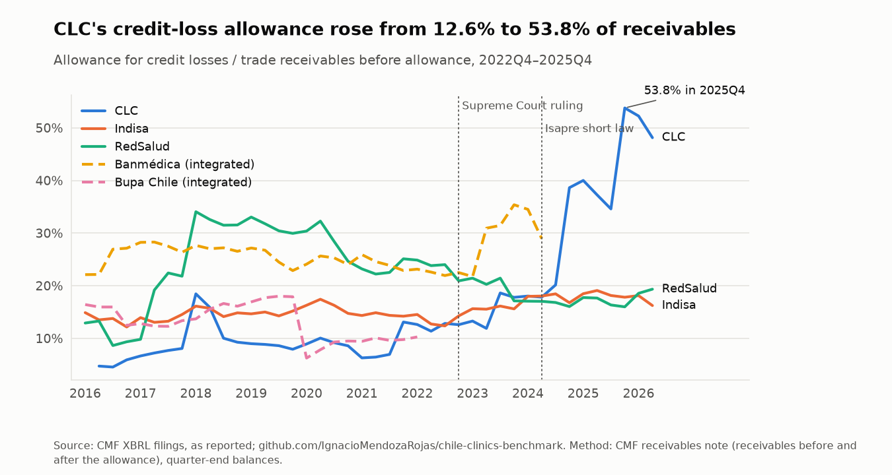
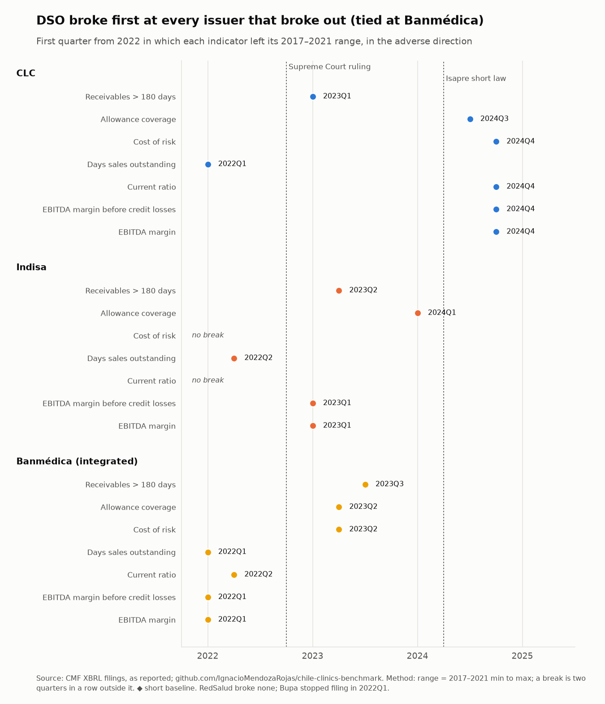
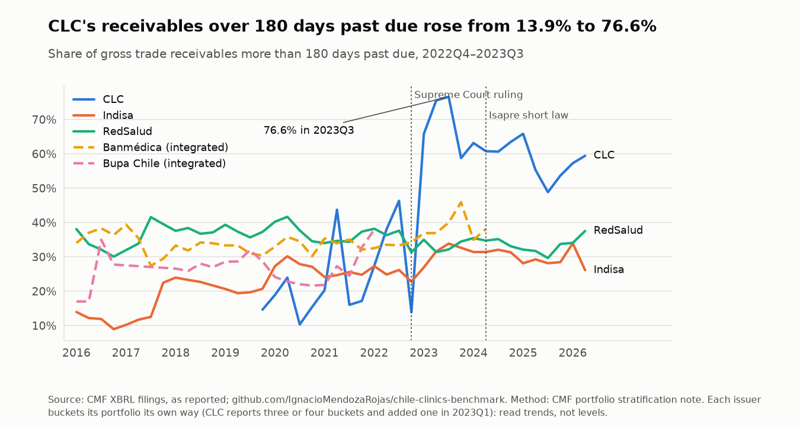
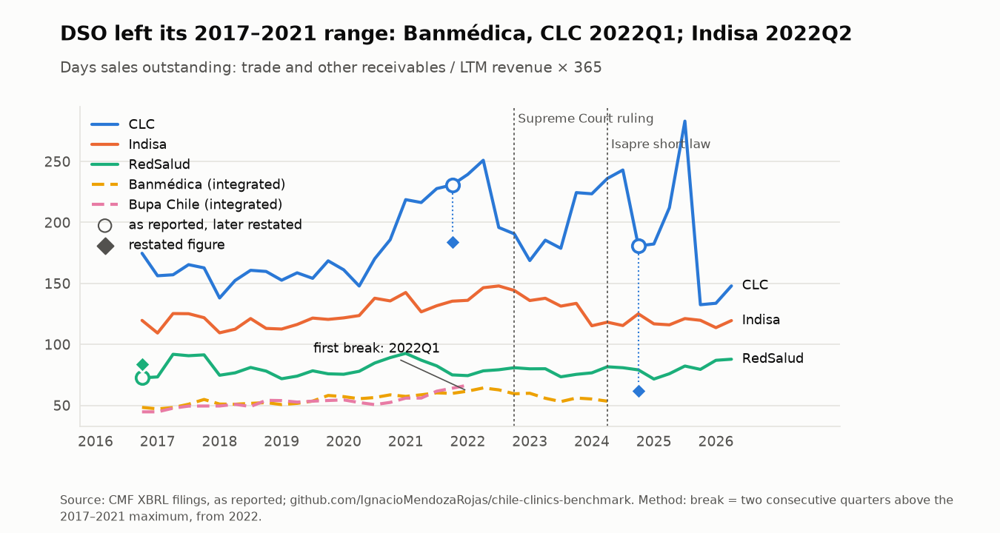
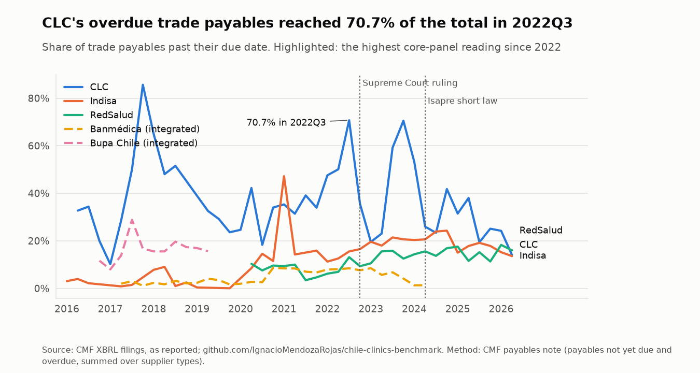
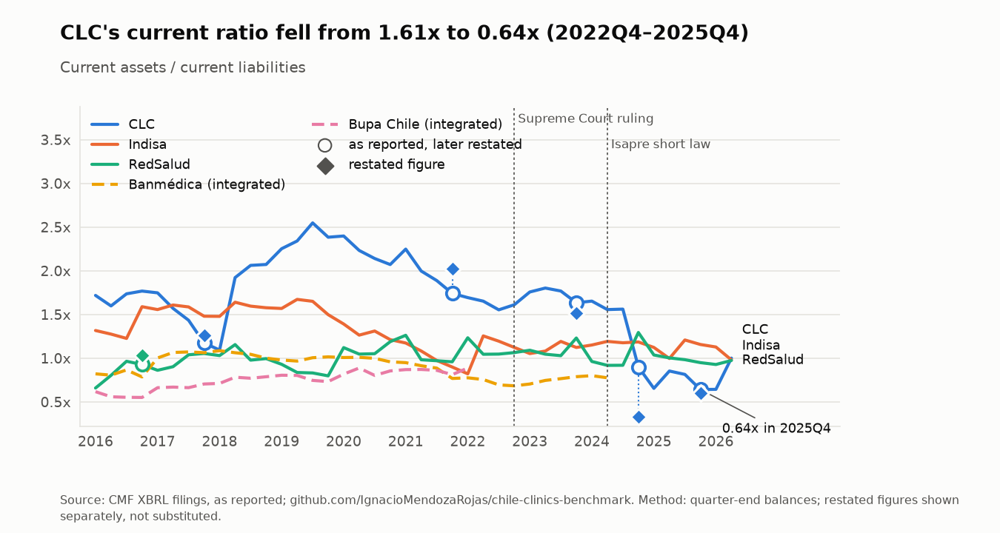
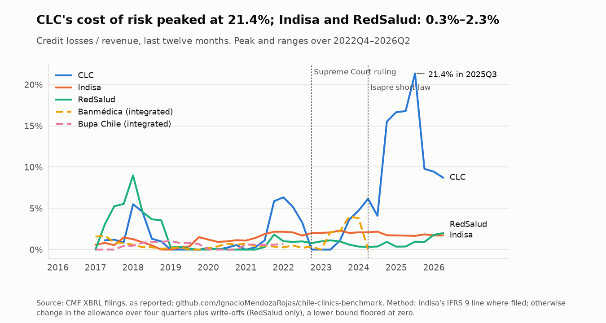
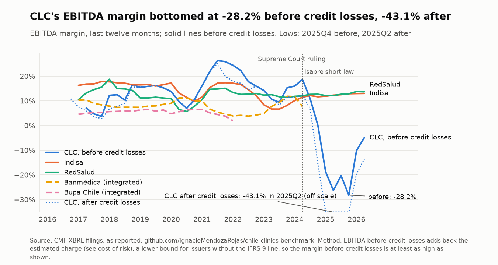

# Chile Clinics Industry Benchmark

[](https://github.com/IgnacioMendozaRojas/chile-clinics-benchmark/actions/workflows/ci.yml)
[](https://github.com/IgnacioMendozaRojas/chile-clinics-benchmark/actions/workflows/update.yml)

**Credit risk and financial statement analysis.** A self-updating benchmark of the Chilean private clinic groups that report to the [CMF](https://www.cmfchile.cl), rebuilt from their quarterly XBRL filings to answer one question: how hard did the Isapre crisis hit them, and did it show up first in receivables, provisions or liquidity?

> In 2023, as Strategy & Investment Analyst at Red Interclínica, I built this benchmark by hand in Excel (competitive benchmarking of Chilean clinic groups). This repository rebuilds it from public CMF filings and keeps it current. No data or templates from that job.

## Results

- **Clínica Las Condes (CLC) quadrupled its provisions.** Its allowance for credit losses rose from 12.6% of gross trade receivables in 2022Q4 to 53.8% in 2025Q4 (at most 18% in 2017–2021).
- **CLC restated its own balance sheet.** Its 2025Q4 filing restated December 2024: trade receivables from CLP 85.2 bn to 26.0 bn and equity from 204.1 bn to 136.6 bn.
- **Indisa and RedSalud absorbed it.** Over 2022Q4–2026Q2 their LTM cost of risk stayed between 0.3% and 2.3% of revenue (CLC peaked at 21.4% in 2025Q3), and in 2026Q2 their EBITDA margin before credit losses was 13.0% and 13.7%.

<picture>
  <source media="(prefers-color-scheme: dark)" srcset="docs/figures/allowance_coverage-dark.png">
  
</picture>

## What this shows

| Task in a credit-risk or investment team | Where it is done here |
|---|---|
| Measure portfolio quality of a counterparty: ageing, allowance coverage, cost of risk | Receivables notes read from XBRL dimensions ([`notes.py`](src/clinics/notes.py)), cost of risk from the IFRS 9 line or the allowance roll-forward ([`credit.py`](src/clinics/credit.py)) |
| Catch restatements instead of silently mixing bases | Every figure as reported; later comparatives logged in [`restatements.csv`](data/processed/restatements.csv) and drawn next to the original |
| Compare peers on the same definitions | One concept map for five issuers ([`config/concepts.yaml`](config/concepts.yaml)), providers and integrated groups flagged |
| Early warning: which indicator breaks first | First quarter outside the 2017–2021 range, per issuer and indicator ([`sequence.py`](src/clinics/sequence.py)) |
| Separate credit losses from operating performance | EBITDA margin before and after credit losses, in one chart |
| Explain jumps rather than ignore them | Revaluations and base effects documented with their filing in [`config/known_events.yaml`](config/known_events.yaml) |
| Keep the analysis current without manual work | [`update.yml`](.github/workflows/update.yml) downloads new filings twice a month, validates them, redraws the figures and the reading below |

## Latest reading

<!-- latest:start -->
**Latest reading: 2026Q2.** In 2026Q2, CLC's allowance covered 48% of its gross trade receivables (at most 18% in 2017–2021); LTM cost of risk was 8.7% at CLC, 1.7% at Indisa and 2.0% at RedSalud.

| Indicator | Latest | Quarter before | Change | Note |
|---|---:|---:|---:|---|
| CLC: Allowance for credit losses / gross trade receivables | 48.1% | 52.2% | -4.1 pp |  |
| CLC: Gross trade receivables more than 180 days past due | 59.4% | 57.3% | +2.2 pp |  |
| CLC: Cost of risk (credit losses / revenue, LTM) | 8.7% | 9.4% | -0.7 pp |  |
| CLC: EBITDA margin before credit losses, LTM | -4.9% | -10.1% | +5.2 pp |  |
| Indisa: Allowance for credit losses / gross trade receivables | 16.2% | 18.1% | -1.9 pp |  |
| Indisa: Gross trade receivables more than 180 days past due | 26.1% | 33.9% | -7.8 pp |  |
| Indisa: Cost of risk (credit losses / revenue, LTM) | 1.7% | 1.7% | +0.0 pp |  |
| Indisa: EBITDA margin before credit losses, LTM | 13.0% | 13.0% | +0.0 pp |  |
| RedSalud: Allowance for credit losses / gross trade receivables | 19.3% | 18.6% | +0.8 pp |  |
| RedSalud: Gross trade receivables more than 180 days past due | 37.5% | 34.1% | +3.5 pp |  |
| RedSalud: Cost of risk (credit losses / revenue, LTM) | 2.0% | 1.8% | +0.2 pp |  |
| RedSalud: EBITDA margin before credit losses, LTM | 13.7% | 13.8% | -0.1 pp |  |

*Updated automatically on 2026-10-21 from the CMF filings. pp = percentage points. Cost of risk is estimated from the allowance roll-forward except where the issuer files the IFRS 9 line (see Method). A note gives the quarter when an issuer lags the others.*
<!-- latest:end -->

## What moved first

The answer to the question above, from [`sequence.csv`](data/processed/sequence.csv): for each issuer, the first
quarter from 2022 in which each indicator left its 2017–2021 range in the adverse direction for two consecutive
quarters. **Collection moved first, or jointly first, everywhere it moved at all**: days sales outstanding broke out in 2022Q1–Q2,
before the Supreme Court ruling (at Banmédica together with its margins); receivables ageing and provisioning followed in 2023–2024; liquidity and margins
came last, and only at CLC did they break together with the provisioning.

| Issuer | Order in which indicators left their 2017–2021 range (first quarter) | No break |
|---|---|---|
| CLC | Days sales outstanding (2022Q1) → Receivables > 180 days (2023Q1) → Allowance coverage (2024Q3) → Cost of risk (2024Q4) → Current ratio (2024Q4) → EBITDA margin before credit losses (2024Q4) → EBITDA margin (2024Q4) | — |
| Indisa | Days sales outstanding (2022Q2) → EBITDA margin before credit losses (2023Q1) → EBITDA margin (2023Q1) → Receivables > 180 days (2023Q2) → Allowance coverage (2024Q1) | Cost of risk, Current ratio |
| RedSalud | — | Allowance coverage, Cost of risk, Current ratio, Days sales outstanding, EBITDA margin before credit losses, EBITDA margin, Receivables > 180 days |
| Banmédica | Days sales outstanding (2022Q1) → EBITDA margin before credit losses (2022Q1) → EBITDA margin (2022Q1) → Current ratio (2022Q2) → Allowance coverage (2023Q2) → Cost of risk (2023Q2) → Receivables > 180 days (2023Q3) | — |

\* short pre-crisis baseline (CLC files the ageing note from 2019Q4). Bupa stopped filing in 2022Q1, too early to
test.

<picture>
  <source media="(prefers-color-scheme: dark)" srcset="docs/figures/sequence-dark.png">
  
</picture>

## What the data shows

All figures as reported to the CMF.

- **CLC took the hit in collection, then in provisioning, then everywhere.** Its allowance for credit losses rose
  from 12.6% of gross trade receivables at the end of 2022 to 38.6% at the end of 2024 and 53.8% at the end of 2025.
  In its December 2025 filing it restated December 2024: trade receivables from CLP 85.2 bn to 26.0 bn, equity from
  204.1 bn to 136.6 bn. Its LTM cost of risk peaked at 21.4% of revenue in 2025Q3 (8.7% in 2026Q2).
- **Provisioning explains part of CLC's collapse, not all of it.** Its LTM EBITDA margin fell from 12.5% in mid-2024
  to −43.1% in mid-2025; before credit losses it was −26.3%. The estimate of CLC's credit losses is a lower bound (it
  does not see write-offs), so at least 17 points of the fall were provisioning and the operating margin was −26% or
  better. By 2026Q2 the gap had narrowed to −13.7% after credit losses and −4.9% before.
- **Indisa and RedSalud absorbed it.** Their LTM cost of risk stayed between 0.3% and 2.3% of revenue from the end of
  2022 to 2026Q2, and their EBITDA margin before credit losses ended the period at 13.0% and 13.7%. RedSalud broke out
  of none of its 2017–2021 ranges; Indisa's margin and receivables did in 2023 and have recovered since.
- **Banmédica, which owns an Isapre, moved fastest**: its DSO, margins and liquidity broke out in 2022, and its
  allowance coverage rose from 22.5% at the end of 2022 to 35.4% at the end of 2023, before it stopped filing in 2024.

## Before vs after

| | 2023, by hand | Now |
|---|---|---|
| Source | Figures copied from financial statements, notes, MD&As and annual reports into an Excel workbook | Every quarterly XBRL filing downloaded from the CMF and parsed |
| Coverage | Annual 2016–2022, quarterly 2023 | Every quarter from 2016Q1 to the latest filing (185 filings, five issuers) |
| Update | Repeat the copying for each new quarter | [`update.yml`](.github/workflows/update.yml) runs twice a month (about six minutes) and commits only if validations pass |
| Checks | Visual | Balance sheet and income statement arithmetic, gaps, jumps, restatements, bucket consistency — errors block publication |
| Command | — | `python -m clinics.update && python -m clinics.figures` |

## Figures

Regenerated from the data on every update. Hollow rings mark periods a later filing restated; the diamond is the
restated figure (shown when it moves the indicator by more than 5%). Dashed lines are integrated groups. Titles are
written from the data on every run, so they change when the data does. The allowance chart is shown above.

<picture>
  <source media="(prefers-color-scheme: dark)" srcset="docs/figures/receivables_over_180-dark.png">
  
</picture>

<picture>
  <source media="(prefers-color-scheme: dark)" srcset="docs/figures/dso-dark.png">
  
</picture>

<picture>
  <source media="(prefers-color-scheme: dark)" srcset="docs/figures/payables_overdue-dark.png">
  
</picture>

<picture>
  <source media="(prefers-color-scheme: dark)" srcset="docs/figures/current_ratio-dark.png">
  
</picture>

<picture>
  <source media="(prefers-color-scheme: dark)" srcset="docs/figures/cost_of_risk-dark.png">
  
</picture>

<picture>
  <source media="(prefers-color-scheme: dark)" srcset="docs/figures/ebitda_margin-dark.png">
  
</picture>

## Coverage

| Group | Issuer | RUT | Type | Quarterly XBRL filings |
|---|---|---|---|---|
| Clínica Las Condes | Clínica Las Condes S.A. | 93.930.000-7 | Provider | 2016Q1 – latest |
| Indisa | Instituto de Diagnóstico S.A. | 92.051.000-0 | Provider | 2016Q1 – latest |
| RedSalud | Empresas Red Salud S.A. | 76.020.458-7 | Provider | 2016Q1 – latest |
| Banmédica | Banmédica S.A. | 96.528.990-9 | Integrated (Isapre + clinics) | 2016Q1 – 2024Q2 |
| Bupa | Bupa Chile S.A. | 76.005.001-6 | Integrated (Isapre + clinics) | 2016Q1 – 2022Q1 |

*Providers* keep their receivables from Isapres on the balance sheet. *Integrated* groups own an Isapre, so
intra-group receivables are eliminated on consolidation: they enter every indicator but are flagged and drawn
dashed. Banmédica and Bupa no longer file with the CMF, so their series stop at their last filing — a series ending
is not an improvement. Coverage was checked quarter by quarter with `clinics.probe`.

## Published tables

| File | Contents |
|---|---|
| [`statements.csv`](data/processed/statements.csv) | Issuer × quarter × variable, in CLP: balances, year-to-date flows as filed, the quarter, LTM, and the restated figure where a later filing changed it |
| [`notes.csv`](data/processed/notes.csv) | Issuer × quarter × note item: receivables by days past due, allowance, payables not yet due and overdue |
| [`indicators.csv`](data/processed/indicators.csv) | Issuer × quarter × indicator, with issuer type and panel |
| [`credit_losses.csv`](data/processed/credit_losses.csv) | LTM credit-loss charge per issuer and quarter, with the method used |
| [`sequence.csv`](data/processed/sequence.csv) | Pre-crisis range and first break of each indicator, per issuer |
| [`latest.json`](data/processed/latest.json) | The latest reading, in the same schema as my other self-updating repos |
| [`restatements.csv`](data/processed/restatements.csv) | Figures a later filing presents differently: as reported vs revised |
| [`validation_report.md`](data/processed/validation_report.md) | Errors, warnings, explained findings and context from the latest run |
| [`coverage.csv`](data/processed/coverage.csv) | Which quarters each issuer filed |

## Method

- **As reported.** Every figure comes from the filing of its own period. When a later filing restates a period in
  its comparative columns, the revision is logged and the period is flagged, but not substituted: substituting would
  mix accounting bases inside quarterly and LTM figures (a restated full year minus nine months never restated).
- **Quarters and LTM.** Filings report flows year to date; quarter = YTD(q) − YTD(q−1);
  LTM = YTD(q) + FY(y−1) − YTD(q, y−1). Flow-based ratios use LTM to remove seasonality.
- **Concepts.** 32 variables map to the CL-CI/IFRS tags in [`config/concepts.yaml`](config/concepts.yaml), checked
  against the concepts all five issuers actually file. Costs are taken in absolute value (filers use both sign
  conventions).
- **Notes** come from the CMF's standard note breakdowns, read from XBRL dimensions
  ([`config/notes.yaml`](config/notes.yaml)): portfolio stratification by days past due, receivables before and after
  the allowance, and payables by days to or past due. Issuers bucket their portfolio differently (RedSalud and Indisa
  appear to age from invoice date; CLC reports three or four buckets and added one in 2023Q1), so ageing shares are
  for trends within an issuer. The allowance coverage needs no bucketing and compares across issuers.
- **Definitions.** EBIT = gross profit − distribution − administrative expenses − credit losses presented on the
  face of the income statement (so issuers that show IFRS 9 losses separately and those that include them in
  expenses are measured alike). EBITDA adds depreciation and amortisation, including right-of-use assets from 2019
  (IFRS 16 is a level break). Gross financial debt = other financial liabilities + lease liabilities; net debt
  subtracts cash. Ratios are nominal: both sides come from the same period, so inflation cancels.
- **Credit losses.** Only Indisa files the IFRS 9 credit-loss expense consistently (a line of its income statement
  since 2019Q4), and no issuer tags it in its notes. Elsewhere the LTM charge is estimated from the allowance:
  change over four quarters plus write-offs (filed by RedSalud only). Without write-offs it is a lower bound,
  floored at zero; where both exist (Indisa) the allowance change runs 40–55% below the expense. Cost of risk =
  charge / revenue; EBITDA before credit losses adds the whole charge back to EBITDA, which already deducts the
  income-statement line where it exists. [`credit_losses.csv`](data/processed/credit_losses.csv) records the method.
- **Sequence.** Pre-crisis range = minimum to maximum of 2017Q1–2021Q4 (COVID included, so the test is
  conservative); a break needs two consecutive quarters outside it in the adverse direction.
- **Validations.** Assets = liabilities + equity and no quarter missing inside an issuer's coverage (errors: nothing
  is published); assets = current + non-current, gross profit and net income arithmetic, missing core items,
  quarter-on-quarter jumps, allowance vs gross receivables, payable buckets vs totals, ageing bucket changes and
  restatements are reported. Jumps with a known cause (revaluations of land and buildings at CLC in 2020Q2 and Indisa
  in 2025Q4, the COVID base effect in 2021Q2) are listed in [`config/known_events.yaml`](config/known_events.yaml),
  with the filing that confirms them, and reported as explained. Downloads are retried, so an intermittent CMF failure does not drop a quarter.

The CMF XBRL connector is reused from
[equity-research-engine](https://github.com/IgnacioMendozaRojas/equity-research-engine), where it is validated
against SEC filings.

## Run it

```bash
pip install .
python -m clinics.update --out data/processed   # download, rebuild, validate (exit 1 on errors)
python -m clinics.figures                        # redraw docs/figures/ from data/processed
python -m clinics.probe --quick                  # check which filings can be downloaded
```

Raw filings are downloaded to a temporary directory and deleted after parsing; only aggregated tables are committed.

## Next

Not yet automated: capacity and activity (beds, occupancy, surgeries, m²), the revenue mix by payer (Isapre,
Fonasa, private) and a cross-check against the ratios published in each MD&A. These live in PDF tables
(*Análisis Razonado*) whose layout differs by issuer and year. Revenue growth in real terms (IPC deflator) is also
pending.

## License

MIT
