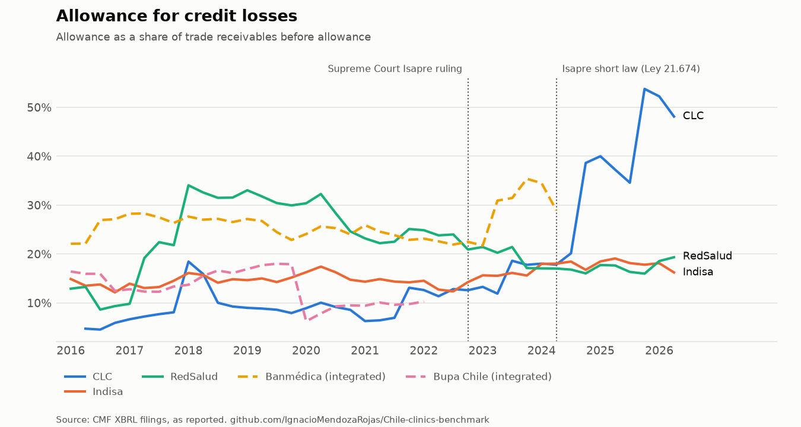
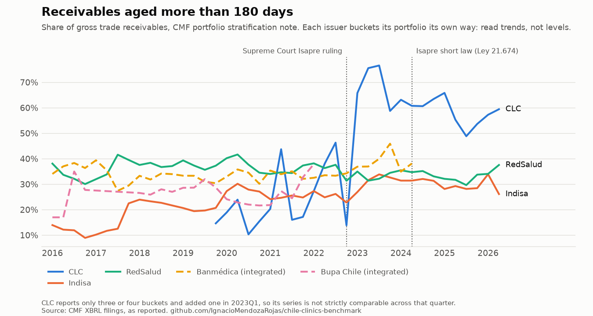
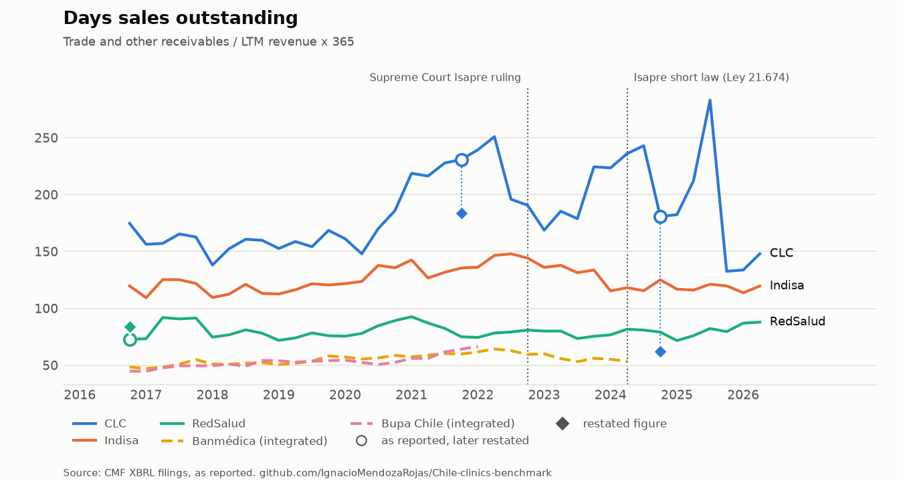
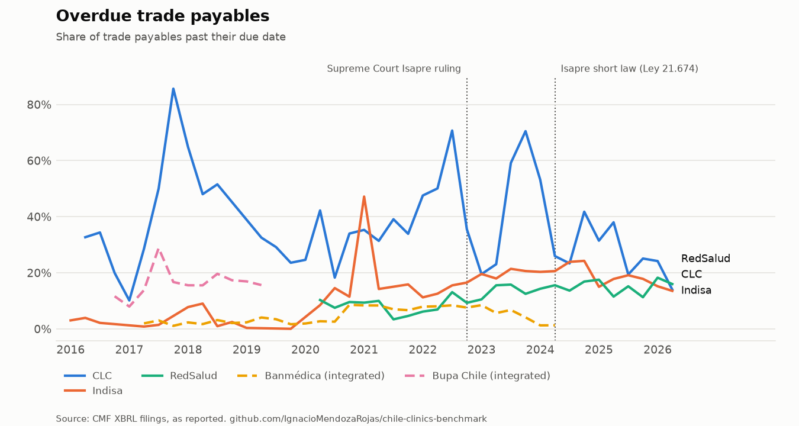
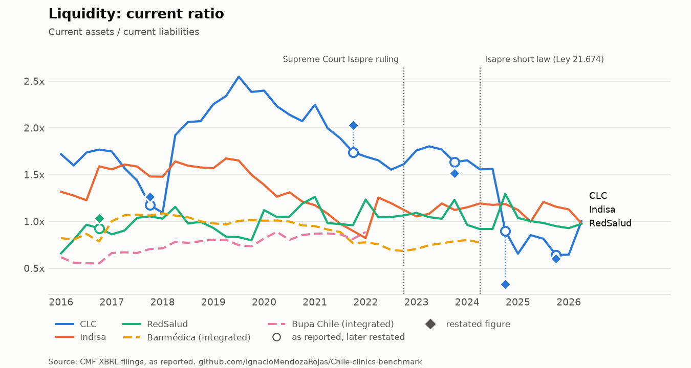
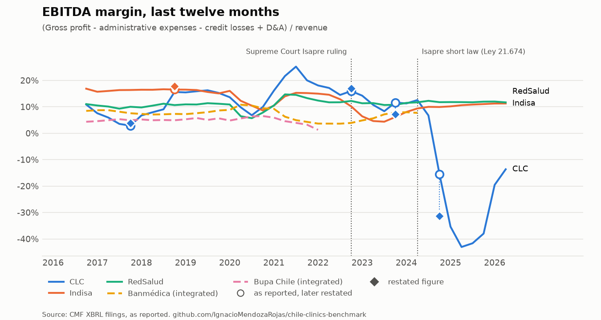

# Chile Clinics Industry Benchmark

**How hard did Chile's Isapre crisis hit the private clinic operators that report to the CMF — and did it show up first in receivables, impairments or liquidity?**

A self-updating benchmark of Chilean private clinic groups, rebuilt entirely from public filings at the
[CMF](https://www.cmfchile.cl) (Comisión para el Mercado Financiero). I first built this benchmark by hand in Excel
in 2023, as a strategy and investment analyst in the sector. This repository rebuilds it from scratch, from public
sources only, and keeps it current without manual work.

<!-- latest:start -->
<!-- latest:end -->

## Before vs after

| | 2023, by hand | Now |
|---|---|---|
| Source | Figures copied from financial statements, notes, MD&As and annual reports into an Excel workbook | Every quarterly XBRL filing downloaded from the CMF and parsed |
| Coverage | Annual 2016–2022, quarterly 2023 | Every quarter from 2016Q1 to the latest filing (185 filings, five issuers) |
| Update | Repeat the copying for each new quarter | [`update.yml`](.github/workflows/update.yml) runs twice a month (about six minutes) and commits only if validations pass |
| Checks | Visual | Balance sheet and income statement arithmetic, gaps, jumps, restatements, bucket consistency — errors block publication |
| Command | — | `python -m clinics.update && python -m clinics.figures` |

## What the data shows

All figures as reported to the CMF.

- **Clínica Las Condes took the hit on its balance sheet first, then in results.** Its allowance for credit losses
  rose from 12.6% of gross trade receivables at the end of 2022 to 38.6% at the end of 2024 and 53.8% at the end of
  2025. In its December 2025 filing it restated December 2024: trade receivables from CLP 85.2 bn to 26.0 bn, equity
  from 204.1 bn to 136.6 bn. Its LTM EBITDA margin went from 12.5% in mid-2024 to −43.1% in mid-2025, and −13.7% by
  2026Q2. Overdue trade payables reached 70.5% of its trade payables at the end of 2023.
- **Indisa and RedSalud absorbed it without breaking trend.** From the end of 2022 to 2026Q2 their allowance
  coverage stayed between 14% and 22%; RedSalud's LTM EBITDA margin held between 10.7% and 12.3%, while Indisa's
  dipped to 4.4% in 2023Q3 and recovered to 11.3% by 2026Q2.
- **Banmédica, which owns an Isapre, raised its allowance coverage** from 22.5% at the end of 2022 to 35.4% at the
  end of 2023, before it stopped filing in 2024.

## Figures

Regenerated from the data on every update. Hollow rings mark periods a later filing restated; the diamond is the
restated figure (shown when it moves the indicator by more than 5%). Dashed lines are integrated groups.








## Coverage

| Group | Issuer | RUT | Type | Quarterly XBRL filings |
|---|---|---|---|---|
| Clínica Las Condes | Clínica Las Condes S.A. | 93.930.000-7 | Provider | 2016Q1 – latest |
| Indisa | Instituto de Diagnóstico S.A. | 92.051.000-0 | Provider | 2016Q1 – latest |
| RedSalud | Empresas Red Salud S.A. | 76.020.458-7 | Provider | 2016Q1 – latest |
| Banmédica | Banmédica S.A. | 96.528.990-9 | Integrated (Isapre + clinics) | 2016Q1 – 2024Q2 |
| Bupa | Bupa Chile S.A. | 76.005.001-6 | Integrated (Isapre + clinics) | 2016Q1 – 2022Q1 |

*Providers* keep their receivables from Isapres on the balance sheet. *Integrated* groups own an Isapre, so
intra-group receivables are eliminated on consolidation: they enter every indicator but are flagged and drawn
dashed. Banmédica and Bupa no longer file with the CMF, so their series stop at their last filing — a series ending
is not an improvement. Coverage was checked quarter by quarter with `clinics.probe`.

## Published tables

| File | Contents |
|---|---|
| [`statements.csv`](data/processed/statements.csv) | Issuer × quarter × variable, in CLP: balances, year-to-date flows as filed, the quarter, LTM, and the restated figure where a later filing changed it |
| [`notes.csv`](data/processed/notes.csv) | Issuer × quarter × note item: receivables by days past due, allowance, payables not yet due and overdue |
| [`indicators.csv`](data/processed/indicators.csv) | Issuer × quarter × indicator (28), with issuer type and panel |
| [`restatements.csv`](data/processed/restatements.csv) | Figures a later filing presents differently: as reported vs revised |
| [`validation_report.md`](data/processed/validation_report.md) | Errors, warnings and context found in the latest run |
| [`coverage.csv`](data/processed/coverage.csv) | Which quarters each issuer filed |

## Method

- **As reported.** Every figure comes from the filing of its own period. When a later filing restates a period in
  its comparative columns, the revision is logged and the period is flagged, but not substituted: substituting would
  mix accounting bases inside quarterly and LTM figures (a restated full year minus nine months never restated).
- **Quarters and LTM.** Filings report flows year to date; quarter = YTD(q) − YTD(q−1);
  LTM = YTD(q) + FY(y−1) − YTD(q, y−1). Flow-based ratios use LTM to remove seasonality.
- **Concepts.** 32 variables map to the CL-CI/IFRS tags in [`config/concepts.yaml`](config/concepts.yaml), checked
  against the concepts all five issuers actually file. Costs are taken in absolute value (filers use both sign
  conventions).
- **Notes** come from the CMF's standard note breakdowns, read from XBRL dimensions
  ([`config/notes.yaml`](config/notes.yaml)): portfolio stratification by days past due, receivables before and after
  the allowance, and payables by days to or past due. Issuers bucket their portfolio differently (RedSalud and Indisa
  appear to age from invoice date; CLC reports three or four buckets and added one in 2023Q1), so ageing shares are
  for trends within an issuer. The allowance coverage needs no bucketing and compares across issuers.
- **Definitions.** EBIT = gross profit − distribution − administrative expenses − credit losses presented on the
  face of the income statement (so issuers that show IFRS 9 losses separately and those that include them in
  expenses are measured alike). EBITDA adds depreciation and amortisation, including right-of-use assets from 2019
  (IFRS 16 is a level break). Gross financial debt = other financial liabilities + lease liabilities; net debt
  subtracts cash. Ratios are nominal: both sides come from the same period, so inflation cancels.
- **Validations.** Assets = liabilities + equity and no quarter missing inside an issuer's coverage (errors: nothing
  is published); assets = current + non-current, gross profit and net income arithmetic, missing core items,
  quarter-on-quarter jumps, allowance vs gross receivables, payable buckets vs totals, ageing bucket changes and
  restatements are reported. Downloads are retried, so an intermittent CMF failure does not drop a quarter.

The CMF XBRL connector is reused from
[equity-research-engine](https://github.com/IgnacioMendozaRojas/equity-research-engine), where it is validated
against SEC filings.

## Run it

```bash
pip install .
python -m clinics.update --out data/processed   # download, rebuild, validate (exit 1 on errors)
python -m clinics.figures                        # redraw figures/ from data/processed
python -m clinics.probe --quick                  # check which filings can be downloaded
```

Raw filings are downloaded to a temporary directory and deleted after parsing; only aggregated tables are committed.

## Next

Not yet automated: capacity and activity (beds, occupancy, surgeries, m²), the revenue mix by payer (Isapre,
Fonasa, private) and a cross-check against the ratios published in each MD&A. These live in PDF tables
(*Análisis Razonado*) whose layout differs by issuer and year. Revenue growth in real terms (IPC deflator) is also
pending.

## License

MIT
